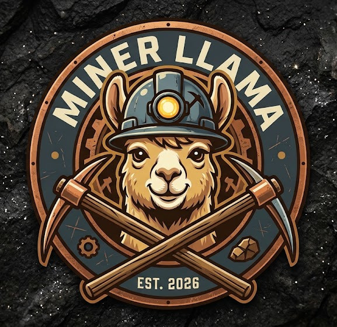

<h1 align="center">Miner Llama</h1>

<b>llama.cpp for retired GPU-mining rigs and other Pascal cards (compute 6.1)</b>

  
  
  
  

Miner Llama is a fork of [llama.cpp](https://github.com/ggml-org/llama.cpp) for NVIDIA's Pascal cards, built and
measured on a Manli mining rig: nine P106-090 cards with 6 GB each, every card on a single PCIe 1.0 lane, and a
2-core Celeron host with 4 GB of RAM. Its kernels, its multi-card pipeline and its model files make that rig run
today's models for a coding agent:

| A coding agent on one rig | Stock llama.cpp b12076 | **Miner Llama v3** | Miner Llama v3, my file |
|---|---:|---:|---:|
| Qwen3.8-Flash-Next 125B, UkisAI's Q2_0 | 8.20 tok/s | **20.40 tok/s** (2.48×) | — |
| Flint 39.8B, Unsloth Q8_0 | 14.4 | **45.9** (3.18×) | 47.4, Flint Pascal Q8 GGUF |
| Flint 39.8B, Unsloth UD-Q5_K_XL | *running now* | *running now* | *running now*, Flint Pascal Q5 GGUF |
| Ornith-1.5-122B, Unsloth UD-Q2_K_XL | 6.0 | **12.6** (2.1×) | 16.3, Ornith-1.5-122B Pascal N2P GGUF |

Stock llama.cpp runs Flint at 65,536 tokens of context, because at 262,144 its attention mask does not fit in the 4 GB
host; Miner Llama runs the full 262,144. Every number, with its command and data, is in the docs repository,
[llms-on-crypto-mining-rigs](https://github.com/Cinderella-Man/llms-on-crypto-mining-rigs).

## Get it

The [v3.0 release](https://github.com/Cinderella-Man/miner-llama/releases/tag/miner-llama-v3.0) has the binaries for
Linux (Ubuntu 24.04, NVIDIA's driver 580) and the CUDA runtime, so no CUDA toolkit is needed. How to set up the rig
and run each model with its preset:
- [Qwen3.8-Flash-Next](https://github.com/Cinderella-Man/llms-on-crypto-mining-rigs/blob/main/release/flash-next-v3/README.md)
- [Flint](https://github.com/Cinderella-Man/llms-on-crypto-mining-rigs/blob/main/release/flint-v3/README.md)
- [Ornith-1.5-122B](https://github.com/Cinderella-Man/llms-on-crypto-mining-rigs/blob/main/release/ornith-v3/README.md)

What each switch does: [docs/switches.md](https://github.com/Cinderella-Man/llms-on-crypto-mining-rigs/blob/main/docs/switches.md). The release notes: [notes-v3.0.md](https://github.com/Cinderella-Man/llms-on-crypto-mining-rigs/blob/main/release/notes-v3.0.md).

## Branches and tags

- `miner-llama` (this branch, the default): the latest release's code, `1551f5fe1` for v3.0, plus this page.
- `miner-llama-v3.0`, `miner-llama-v2.0`: each release's exact code, as tags.
- `pascal-p106-v3-b12076-ladder5`: the v3.0 engine, every feature behind its switch. `pascal-p106-v2` is v2.0's
  engine, `pascal-p106` v1's.
- `master`: upstream llama.cpp.

## Upstream

Everything not listed above is llama.cpp's own, and its README is kept as [README-llama.cpp.md](README-llama.cpp.md).
Miner Llama is MIT-licensed like llama.cpp ([LICENSE](LICENSE)) and is not affiliated with ggml-org. The fixes that
belong upstream are written up in [docs/upstream_fixes.md](https://github.com/Cinderella-Man/llms-on-crypto-mining-rigs/blob/main/docs/upstream_fixes.md).
